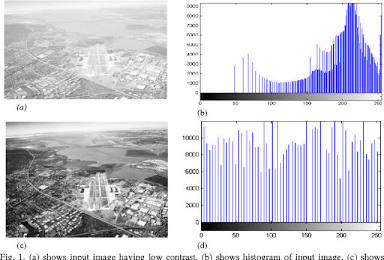

# Exercise 2

* What information can be obtained from a histogram?
A: A histogram shows the count of specific instances of something; it is a special type of bar chart.
In the context of digital images, one usually uses a color histogram, which counts the amount of pixels with a certain color instensity.
I.e. in a three-channel image, three histograms can be obtained (for R, G and B) where the histogram plots the amount of pixels against the intensity of said channel, giving us a count of these color intensities.

* What information cannot be obtained from a histogram?
A: Order of specific instances happening. 
I.e. (5,2,3,5,6,2,3,5)
    (3*5, 2*2, 2*3, 1*6)
In images, specifically, this means that the image can not be reconstructed from a histogram alone, as the histogram tells us the amount of certain color values, but not which pixel they correspond to, and what other color channel values they correspond to.

* Which image properties can be changed by histogram manipulation?
A: The image contrast, brightness, dynamic range, detail visibility and color balance. 

* Can histogram manipulation subsequently eliminate errors made during image capture? Explain its possibilities and limitations.
A: The answer depends on the type of error made during image capture. For instance, an overly bright image may be "fixed" by modifying the histogram, by reducing the amount of bright pixels and "moving" them to the darker side of the histogram.
However, such errors during capture may induce loss of information which histogram manipulation can not compensate for (e.g. if the sensor reports a maximum value in brightness for large regions; no distinction can be made between such pixels in such a case).