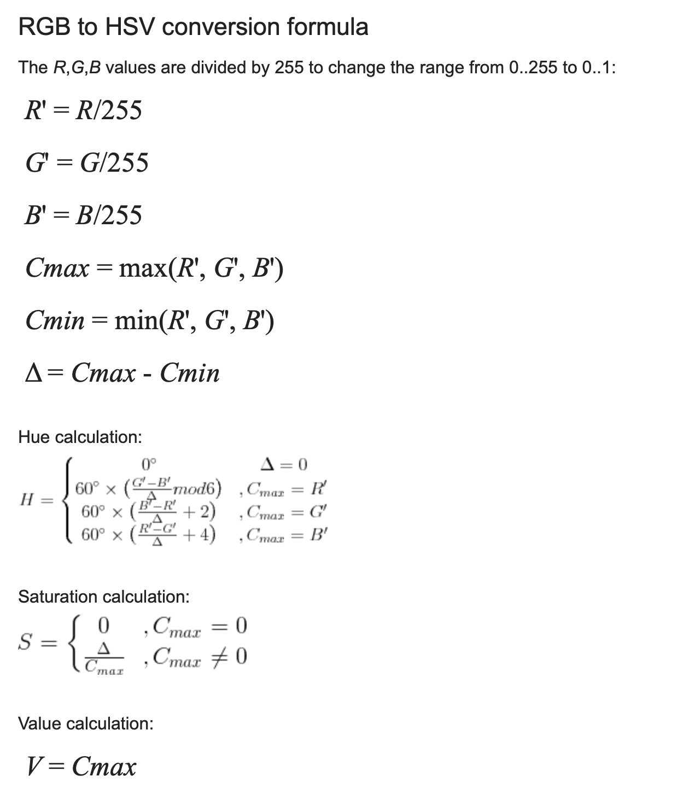

# Exercise 1

* Explain digital images and their properties. Address pixel, color depth, and resolution.
A: A digital image is a representation of intensity  values over a 2D plane. It is typically sampled in units called pixels, where each pixel corresponds to a tiny quadratic zone on the 2D plane. In a color image, three "channels" for red, green and blue are used to store the intensity of each color per pixel, which enables to represent colors similarly to human perception. However, a single 8-bit channel would allow for black-and-white images, a single 1-bit channel would allow for a strictly monochrome image, and any other variations are technically possible (though not necessarily sensible).
A common representation is 24-bit color representation as RGB, where 8 bits are available for each color channel, allowing intensities ranging from 0-255. The amount of bits available per color is referred to as "color depth", more color depth allows for differentiating between more colors.
Resolution refers to the amount of pixels (and aspect ration of the 2D plane); higher resolution means that the image is larger and thus more information may be encoded in it. E.g. an image may have a resolution of 1920x1080 pixels.

* Explain the concept of a color space and summarize RGB, YUV, HSV, and CMYK. For what applications were these color spaces developed?
A: coordinate or representation
system in which each color is represented/located by a coordinate within this space.
     - RGB is a color space mostly used in modern displays. It is based on additive mixing of colors, i.e. every value adds up to white. There are 3 channels (R, G, B).
     - CMYK (YMCK) is a color space used by printers. It is a subtractive color space and the exact opposite of RGB Yellow, Magenta, Cyan. All together results in black. An additional "K" (for "key") channel exists to waste less color by adding one black toner directly, rather than having to mix all others fully. This also results in a cleaner-looking black.
     - HSV (Hue, Saturation, Value) is easier to handle intuitively for humans. Hue contains the pure color tone like red or green, Saturation contains the color intensity (i.e. how far from grey the color appears) and value is its brightness. 
     - YUV Image information and color intensity split into luminance (1 channel = brightness) and chrominance (2 channels for color). Used by television for example and the Y stands for luminance and the U and V stands for chrominance. It offers advantages for image and video compression as colors are roughly uniformly distributed, while brightness is not and light yields contrasts and brightness differences. 
     Note: Several YUV-like color spaces exist, and there are different versions of RGB to YUV conversion.


* Explain how to convert YUV, HSV, and CMYK colors from and to RGB. Convert R=225; G=135; B=60 to HSV, CMY, and CMYK.
A: 

CMY:
* C = 255 - R => C = 255 - 225 = 30
* M = 255 - G => M = 255 - 135 = 120
* Y = 255 - B => Y = 255 - 60 = 195

CMYK:
* K = min{30, 120, 195} = 30
* C = C - K = 30 - 30 = 0
* M = M - K = 120 - 30 = 90
* Y = Y - K = 195 - 30 = 165

HSV:
* H = 27
* S = 73.3
* V = 88.2
* https://www.rapidtables.com/convert/color/rgb-to-hsv.html


YUV:
* Y = 0.299 * R + 0.587 * G + 0.114 * B = 135,36
* U = B - Y = -75,36 
* V = R - Y = -0,36


* Research how Pillow represents an RGB pixel and how it is represented in a NumPy image array. Explain channel order, array shape, data type, and the value range per channel. Consult the Pillow and NumPy documentation.
A: 
The following is the only clanker slop in this entire assignment:
```py
import numpy as np
from PIL import Image

# 1. Create a 3x2 RGB Pillow image (Width = 3, Height = 2)
width, height = 3, 2
pil_img = Image.new("RGB", (width, height), color=(255, 128, 64))

# 2. Convert the Pillow image to a NumPy array
np_arr = np.array(pil_img)

# --- PILLOW REPRESENTATION ---
print("=== PILLOW (PIL) IMAGE ===")
print(f"Mode:             {pil_img.mode}")
print(f"Dimensions (W,H): {pil_img.size}")             # (Width, Height)
print(f"Pixel at (x=0,y=0): {pil_img.getpixel((0, 0))}") # (R, G, B) tuple

# --- NUMPY ARRAY REPRESENTATION ---
print("\n=== NUMPY ARRAY ===")
print(f"Shape (H, W, C):  {np_arr.shape}")            # (Height, Width, Channels)
print(f"Data Type:        {np_arr.dtype}")            # uint8
print(f"Value Range:      {np_arr.min()} to {np_arr.max()}")
print(f"Pixel at [row=0, col=0]: {np_arr[0, 0]}")     # [R, G, B] ndarray
```
